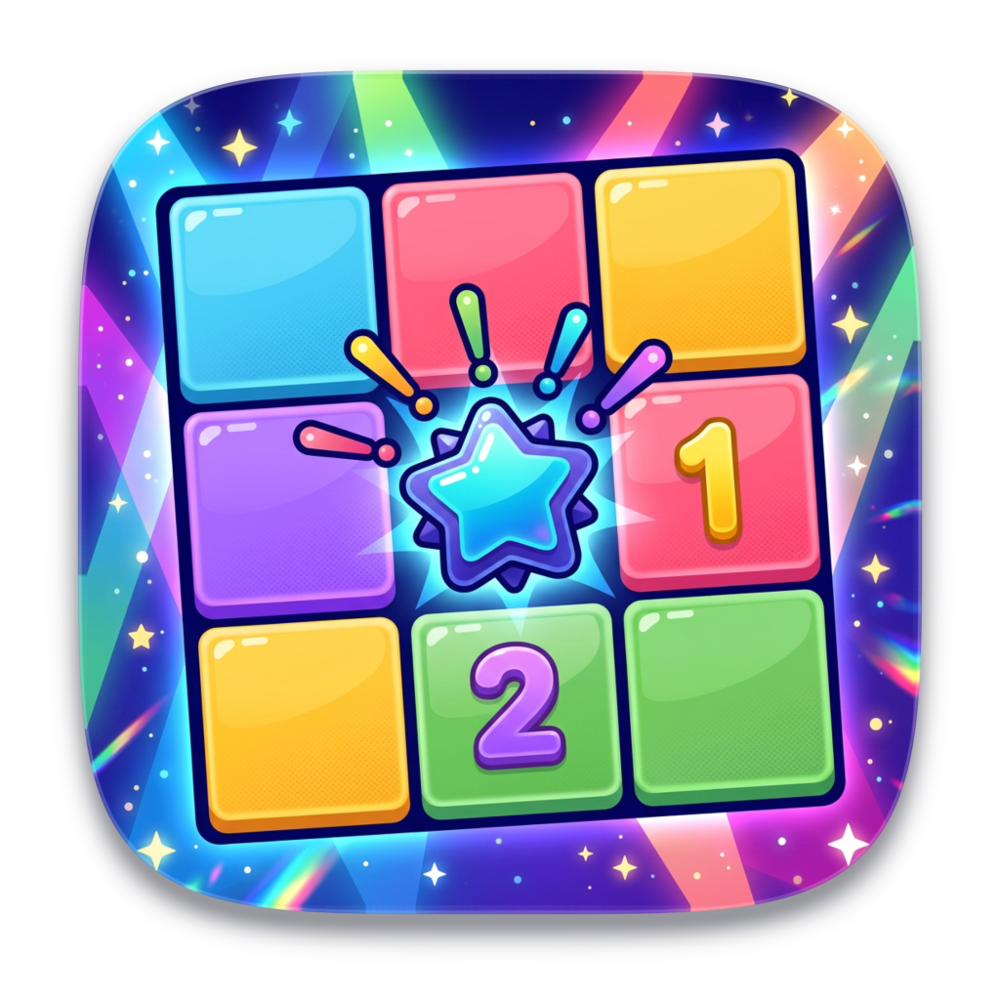
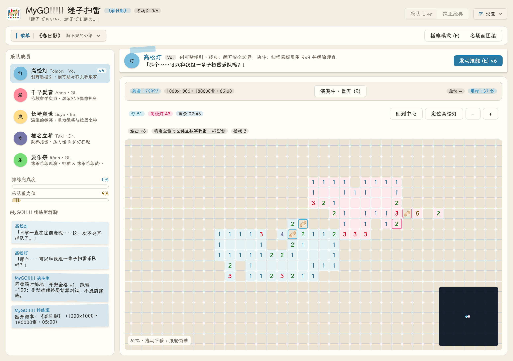

<div align="center">



# MyGO!!!!! 迷子扫雷

**「迷子でもいい、迷子でも進め。」**

*BanG Dream! It's MyGO!!!!!* 非盈利同人桌面扫雷

翻开高松灯的方格笔记本——在米白纸面与深夜台灯之间，把藏在心里的**心结**化成**雷**，贴上一张**创可贴**作为**旗**；带着五位性格各异的少女，沿七首曲目阶梯从零散排练一路走到同盘决斗。

</div>

> [!NOTE]
> **声明**：本项目的初衷是为了测试gemini的玩梗能力，不代表本人的立场，如有冒犯，我先磕头

---

## 实机画面 · Live Showcase

<table>
  <tr>
    <td width="50%" align="center">
      
      <br />
      <sub><b>经典 · 日间（《碧天伴走》16×16）</b> · 米白方格纸、创可贴旗、代表色墨水数字、排练完成度与排练室群聊</sub>
    </td>
    <td width="50%" align="center">
      
      <br />
      <sub><b>经典 · 夜间（《碧天伴走》16×16）</b> · 深夜台灯暖光下的深色方格纸、常驻领队便条、排练完成度、乐队重力值与排练室群聊</sub>
    </td>
  </tr>
  <tr>
    <td width="50%" align="center">
      
      <br />
      <sub><b>决斗 · 日间（《春日影》1000×1000）</b> · 玩家与高松灯 AI 蓝粉高对比领地争夺、<code>+75/雷</code> 即时收雷提示与深色决斗小地图</sub>
    </td>
    <td width="50%" align="center">
      
      <br />
      <sub><b>决斗 · 夜间（《春日影》1000×1000）</b> · 深夜台灯纸面下的蓝粉高对比领地争夺、实时比分与深色决斗小地图</sub>
    </td>
  </tr>
</table>

---

## 一图看懂玩法与五人技能 · Visual Guide

<p align="center">
  
</p>

<p align="center">
  
</p>

---

<details>
<summary><b>展开查看完整规则细节（七首曲目阶梯 / 决斗结算细则）</b></summary>

<br />

- **游玩模式**：
  - **乐队 Live**：启用五人领队专属技能充能（含长崎爽世被动护盾）、乐队重力值、6 项名场面图鉴、技能台词签条与排练室群聊。
  - **纯正经典**：关闭主动与被动技能（充能为 `0`），保留常驻台词应援、乐队重力值、6 项名场面图鉴与排练室群聊（决斗曲目固定启用技能充能）。
- **七首曲目阶梯与初始充能**：
  - **经典 5 首**：
    - 羽丘天文部《迷星叫》`9×9 · 10 雷 · ×1`
    - RiNG 排练室《碧天伴走》`16×16 · 40 雷 · ×2`
    - 《影色舞》`30×30 · 150 雷 · ×3`
    - 一辈子契约《诗超绊》`50×50 · 425 雷 · ×4`
    - 《迷路日々》`100×100 · 1,660 雷 · ×5`
  - **决斗 2 首**（与高松灯 AI 同盘限时争夺蓝粉高对比领地）：
    - 《潜在表明》`500×500 · 45,000 雷 · ×5 · 3 分钟限时`
    - 春日影 Live · 解不完的心结《春日影》`1000×1000 · 180,000 雷 · ×6 · 5 分钟限时`（比分输给高松灯 AI 时触发「为什么要演奏春日影！？」名场面演出）
- **决斗结算与交互细则**：
  - **公平高松灯 AI**：本地高松灯 AI 仅根据棋盘上已公开的格子与数字进行推理，绝不读取隐藏雷位。
  - **数字左键交互**：当公开未知邻居数等于 `数字 - 已知雷数`（已插旗或已爆炸，护盾格不重复计数）时显示**金色荧光笔高亮**，左键点击该数字即可收雷（全为真雷时插旗 `+75/雷`；若因周围错旗混入安全格，则仅翻开其中的安全格并按常规 `+1/格` 计分，不触发收雷加分或自动引爆真雷）；当已知雷数等于数字时显示**代表色荧光笔高亮**并触发一键连开。
  - **插旗与硬直**：手动插旗在终局统一结算（对 `+75` / 错 `-30`），不提前泄露真伪；踩雷 `-100` 分并硬直 `2.4` 秒，比赛不直接结束。
  - **长崎爽世说明**：被动护盾在踩雷时自动消耗充能免扣分与硬直，并替你插上一张创可贴作为己方旗；当前版本决斗中手动按 `E` 仍会消耗 1 次充能触发 `7` 秒 `9×9` 扫描并延缓高松灯 AI 行动 `1.2` 秒。
  - **大棋盘与决斗视野**：在两首决斗曲目与 `50×50` / `100×100` 大棋盘经典曲目中，支持拖动棋盘平移，滚轮/触控板或 `Ctrl + =` / `Ctrl + -` 缩放，`Ctrl + 0` 回到当前棋盘中心，以及点击右下角小地图快速跳转视野；决斗曲目另可使用「回到中心」「定位高松灯」按钮。

</details>

<details>
<summary><b>English Summary (Overview, Controls & Attribution)</b></summary>

<br />

**MyGO!!!!! Minesweeper** is an unofficial, non-commercial *BanG Dream! It's MyGO!!!!!* fan-made desktop Minesweeper set inside Tomori Takamatsu's graph-paper notebook, where every mine is a tangled knot and every flag is a Band-Aid.

- **Modes & 7-Track Setlist**: 5 classic tracks scaling from `9×9` to `100×100` (*迷星叫* `9×9` · 10 mines, *碧天伴走* `16×16` · 40 mines, *影色舞* `30×30` · 150 mines, *诗超绊* `50×50` · 425 mines, *迷路日々* `100×100` · 1,660 mines) plus 2 timed territorial duels against a fair **Tomori Takamatsu AI** that reasons solely from revealed board information (`500×500` · 45,000 mines *潜在表明* in 3 min and `1000×1000` · 180,000 mines *春日影* in 5 min; losing *春日影* triggers the iconic *"Why did you play Haruhikage?!"* scene). **Band Live** enables member skills; **Pure Classic** sets skill charges to `0` while keeping quote cheers, the Gravity meter, 6 meme achievements, and band rehearsal chat.
- **Controls**: Left-click reveals, auto-opens satisfied numbers, or claims surrounding mines in Duel by clicking a gold-highlighted satisfied number; right-click places or removes Band-Aid flags (or cycles `?` marks in Classic when enabled in Settings); `E` triggers leader skill; `F` toggles Flag Mode; `R` restarts. In Duel and large classic boards (`50×50` / `100×100`), drag to pan, scroll/pinch or `Ctrl + =` / `Ctrl + -` to zoom, `Ctrl + 0` to center on the current board, or click the corner minimap to jump.
- **Duel Scoring**: Safe reveals `+1`; clicking a gold-highlighted satisfied number claims surrounding mines for `+75/mine` (if wrong flags leave safe cells mixed in, only safe cells are revealed without mine-claim bonus); stepping on a mine costs `-100` and stuns for `2.4s`; un-claimed manual flags settle at match end (`+75` right / `-30` wrong).
- **Band Leaders**: **Tomori** (frontier safe reveal / duel `9×9` scan + stun cleanse), **Anon** (2 safe reveals / duel combo cash-in up to `+75`), **Soyorin** (passive mine shield; pressing `E` in Duel also spends 1 charge for scan + AI delay), **Taki** (frontier mine flag / duel `+3.0s` AI delay), and **Rāna** (0-mine blank flood / duel scan + AI delay), all inked in their official Image Colors with synthesized stationery and short instrumental motifs.

</details>

---

## 非盈利同人声明与开源协议 · Attribution & License

- **非盈利同人致敬**：本项目为个人非盈利同人二次创作，仅供同好交流与粉丝娱乐，与官方无任何隶属或背书关系。*BanG Dream! It's MyGO!!!!!* 相关角色、名称、台词梗与曲目名称等知识产权均归 **Bushiroad Inc. / BanG Dream! Project** 及各自原版权方所有。
- **原创绘制 + OFL 字体**：仓库不打包任何官方立绘、官方标志字形或受版权保护的音频；方格纸界面、五色感叹号创可贴应用图标、心结与创可贴道具均为原创绘制，纸笔文具与五人短器乐动机音效由代码实时合成；内嵌子集化的开源字体 **霞鹜文楷（LXGW WenKai）** 遵循 **[SIL Open Font License 1.1](resources/fonts/OFL.txt)**。
- **代码开源协议**：本仓库原创代码采用 **[MIT License](LICENSE)** 开源（仅适用于原创代码本身，不授予任何第三方 IP 的使用或商业授权）。

---

## 运行说明 · Run & Build

环境要求：**Go 1.27.3+**（见 [`go.mod`](go.mod)）。

```bash
# 直接启动桌面端
go run .

# 运行全部测试
go test ./...

# 编译当前平台独立可执行文件（输出至 build/ 目录）
go build -o build/ .
```
