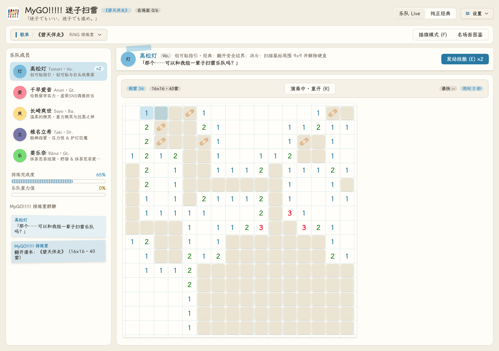
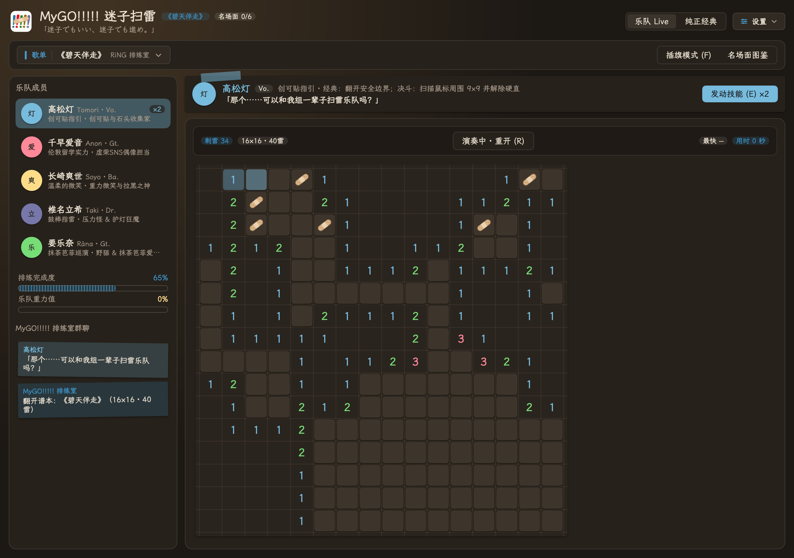
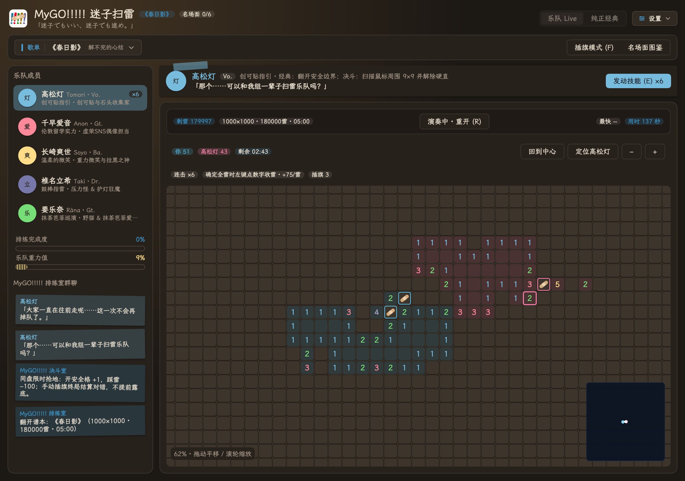
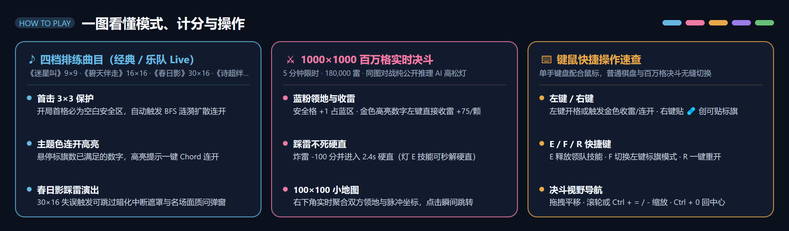
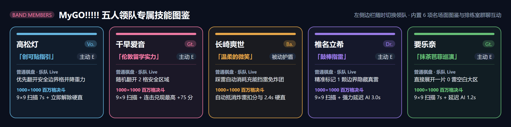

<div align="center">


# MyGO!!!!! 迷子扫雷

**「迷子でもいい、迷子でも進め。」**

纯 Go 原生 GPU 桌面扫雷 · *BanG Dream! It's MyGO!!!!!* 非盈利同人作品  
Built with [`egoist/mygo`](https://github.com/egoist/mygo) · Direct3D 11 / Metal / OpenGL · 零 WebView · 零 `cgo` · [MIT License](LICENSE)

</div>

> [!NOTE]
> **声明**：本项目的初衷是为了测试gemini的玩梗能力，不代表本人的立场，如有冒犯，我先磕头

---

## 实机画面 · Live Showcase

<table>
  <tr>
    <td width="50%" align="center">
      
      <br />
      <sub><b>经典 · 日间（《碧天伴走》16×16）</b> · 米白方格纸、创可贴旗、代表色连开高亮与排练室群聊</sub>
    </td>
    <td width="50%" align="center">
      
      <br />
      <sub><b>经典 · 夜间（《碧天伴走》16×16）</b> · 深夜台灯下的深色方格纸、排练完成度、乐队重力值与排练室群聊</sub>
    </td>
  </tr>
  <tr>
    <td width="50%" align="center">
      
      <br />
      <sub><b>决斗 · 日间（《春日影》1000×1000）</b> · 玩家与高松灯 AI 蓝粉高对比领地争夺、<code>+75</code> 即时收雷与深色决斗小地图</sub>
    </td>
    <td width="50%" align="center">
      
      <br />
      <sub><b>决斗 · 夜间（《春日影》1000×1000）</b> · 深夜台灯纸面下的蓝粉高对比领地争夺、实时比分与深色决斗小地图</sub>
    </td>
  </tr>
</table>

---

## 一图看懂玩法与五人技能 · Visual Guide

<p align="center">
  
</p>

<p align="center">
  
</p>

---

## 快速开始 · Quick Start

环境要求：**Go 1.27.3+**（见 [`go.mod`](go.mod)），无需安装 `cgo`、Node.js 或浏览器环境。

```bash
# 直接启动桌面端
go run .

# 运行引擎逻辑与 Native UI 内存交互测试
go vet ./... && go test -v ./...

# 编译当前平台独立可执行文件（输出至已忽略的 build/ 目录）
go build -o build/ .

# 跨平台打包 macOS Universal (.app)
go run github.com/egoist/mygo/cmd/mygo@v0.9.2 build -platform darwin/universal -o build
```

<details>
<summary><b>展开查看完整规则细节（曲目规格 / 决斗结算细则）</b></summary>

<br />

- **游玩模式**：
  - **乐队 Live**：启用五人领队专属技能充能、重力值（Gravity）警戒仪表、6 项名场面图鉴与排练室群聊。
  - **纯正经典**：关闭技能（充能为 `0`），仅保留台词应援、重力值、名场面与群聊（百万格决斗固定为乐队模式）。
- **曲目尺寸与初始充能**：
  - 羽丘天文部《迷星叫》`9×9 · 10 雷 · ×1` ｜ RiNG 排练室《碧天伴走》`16×16 · 40 雷 · ×2`
  - 春日影 Live《春日影 (Crychic Ver.)》`30×16 · 99 雷 · ×3` ｜ 一辈子契约《诗超绊》`20×20 · 80 雷 · ×3`
  - 百万格决斗《诗超绊 · 决斗 Live》`1000×1000 · 180,000 雷 · ×6 · 5 分钟限时`
- **百万格决斗细则**：
  - **公平 AI**：本地高松灯 AI 仅基于增量维护的公开边界与公开数字推理，绝不读取隐藏雷位。
  - **数字左键交互**：当公开未知邻居数等于 `数字 - 已知雷数`（已插旗或已爆炸，护盾格不重复计数）时显示**金色高亮**，左键可直接收雷（全为真雷时插旗 `+75/颗`；若因周围错旗混入安全格，则仅翻开其中的安全格并按常规 `+1/格` 计分，不触发收雷加分或自动引爆真雷）；当已知雷数等于数字时显示**领队色高亮**并触发 Chord 连开。
  - **插旗与硬直**：手动插旗在终局统一结算（对 `+75` / 错 `-30`），不提前泄露真伪；踩雷 `-100` 分并硬直 `2.4s`，比赛不直接结束。
  - **长崎爽世说明**：被动护盾在踩雷时自动消耗充能免扣分与硬直并记为己方标记雷；当前版本决斗中手动按 `E` 仍会消耗 1 次充能触发 `7s` 扫描与 `1.2s` AI 延迟。
  - **视野操作**：左/中/右键拖拽（移动 >5px）平移；滚轮/触控板或 `Ctrl + =` / `Ctrl + -` 缩放；`Ctrl + 0` 回到中心 `(500, 500)`。

</details>

<details>
<summary><b>English Summary (Overview, Controls & Attribution)</b></summary>

<br />

**MyGO!!!!! Minesweeper** is an unofficial, non-commercial fan-made desktop Minesweeper game built in pure Go with [`github.com/egoist/mygo`](https://github.com/egoist/mygo) (Direct3D 11 on Windows, Metal on macOS, OpenGL on Linux — zero WebView, zero `cgo`).

- **Modes & Setlist**: 4 classic boards (*Mayoiuta* `9×9`, *Hekiten Bansou* `16×16`, *Haruhikage* `30×16`, *Utakotoba* `20×20`) plus a **5-minute `1000×1000` Million-Cell Duel** (`180,000` mines) against a fair public-frontier **Tomori Takamatsu AI**. Band Live Mode enables member skills; Classic Mode disables skills (`0` charges) while keeping cheers, Gravity meter, 6 meme achievements, and band chat.
- **Controls**: Left-click reveals/chords (`F` toggles Flag Mode); right-click places Band-Aid flags or cycles `?` marks; `E` activates leader skill; `R` restarts. In Duel, drag (>5px) to pan, scroll/pinch or `Ctrl + =` / `Ctrl + -` to zoom, `Ctrl + 0` to center at `(500, 500)`, or click the `100×100` dual-color minimap to jump.
- **Duel Scoring**: Safe reveals `+1`; clicking a gold-highlighted satisfied number claims surrounding mines for `+75/mine` (if wrong flags leave safe cells mixed in, only safe cells are revealed without mine-claim bonus); stepping on a mine costs `-100` and stuns for `2.4s`; un-claimed manual flags settle at match end (`+75` right / `-30` wrong).
- **Band Leaders**: **Tomori** (frontier safe reveal / duel `9×9` scan + stun cleanse), **Anon** (2 safe reveals / duel combo cash-in up to `+75`), **Soyorin** (passive mine shield; pressing `E` in Duel also spends 1 charge for scan + AI delay), **Taki** (frontier mine flag / duel `+3.0s` AI delay), and **Rana** (0-mine blank flood / duel scan + AI delay).
- **Build & Test**: Requires **Go 1.27.3+**. Run `go run .`, `go vet ./...`, and `go test -v ./...`.

</details>

---

## 非盈利同人声明与开源协议 · Attribution & License

- **非盈利同人致敬**：本项目为个人非盈利同人二次创作，仅供技术交流与粉丝娱乐，与官方无任何隶属或背书关系。*BanG Dream! It's MyGO!!!!!* 相关角色、名称、台词梗与曲目名称等知识产权均归 **Bushiroad Inc. / BanG Dream! Project** 及各自原版权方所有。
- **零官方素材打包**：仓库不包含任何受版权保护的音频或官方立绘/标志素材；应用图标为纯原创几何波普设计，界面与头像均由原生代码实时绘制。
- **代码开源协议**：本仓库原创 Go 源代码采用 **[MIT License](LICENSE)** 开源（仅适用于原创代码本身，不授予任何第三方 IP 的使用或商业授权）。
